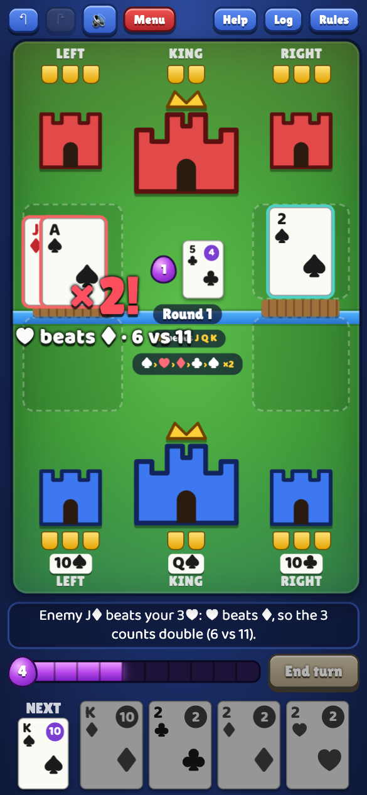
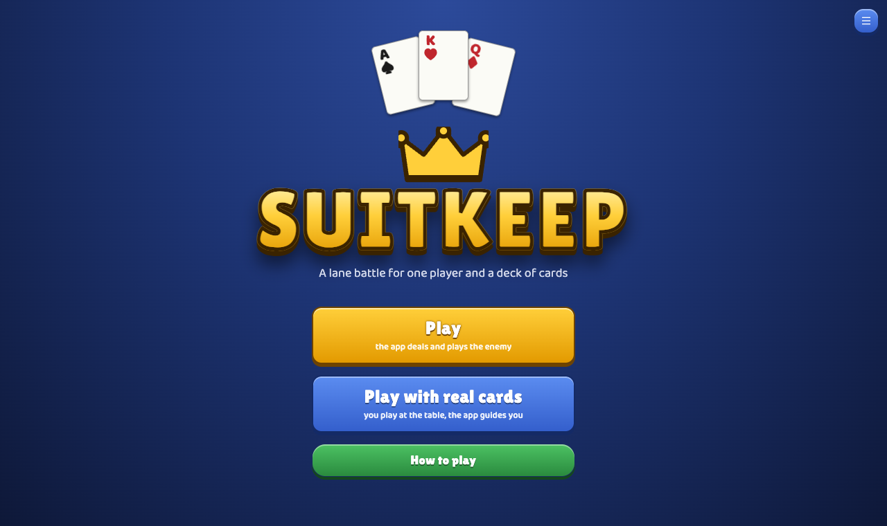
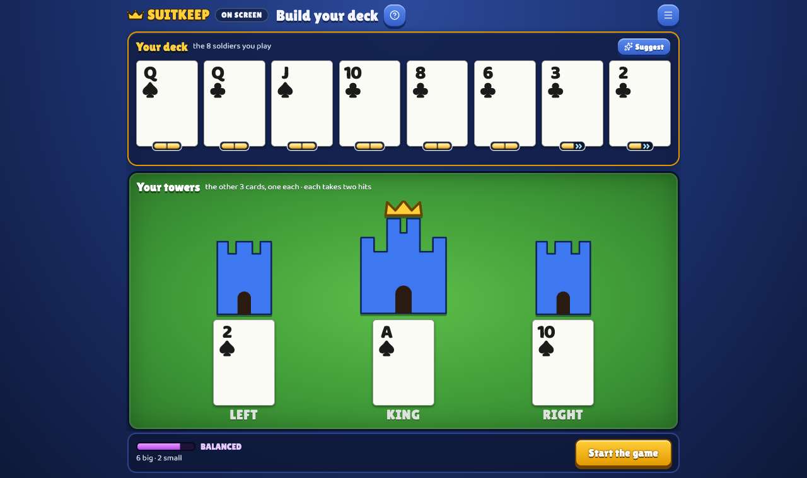
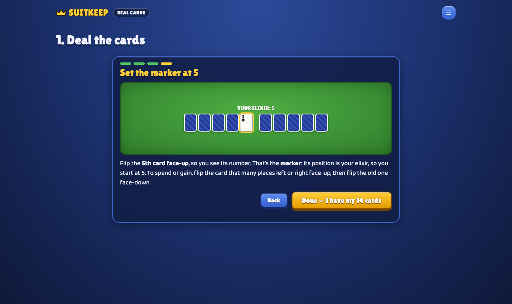

# Kingfall: a solo card game with a standard 52-card deck

**Kingfall is a free one-player lane battle card game.** Spend elixir, send your cards down two lanes, clash with the enemy's cards in the middle, crack its towers and take down its king. It's inspired by real-time lane games like Clash Royale, but it's turn-based and needs nothing but a deck of playing cards.

### ▶ [Play Kingfall in your browser](https://kingfall-card-game.vercel.app)

Free, no sign-up, works on phones and desktops.

<p align="center">
  
  &nbsp;
  
</p>

## Two ways to play

- **On screen.** The app deals, runs the enemy and animates every fight. Your first game teaches you as you play: the app builds your deck, suggests moves, and explains one rule at a time, starting with the goal.
- **With real cards.** Shuffle a real 52-card deck and play at the table. The app is your companion: it runs the enemy automaton and tells you exactly what to move at each step. Your first game at the table also says why at every step. The [rulebook](RULEBOOK.md) is complete without the app, so it also works as a print-and-play solitaire game.

## How to play in one minute

- **Goal:** destroy the enemy's king tower (a stack of 2 cards) before it destroys yours.
- **Cards are soldiers.** Higher rank wins a fight (A=1 … K=13).
- **Suit wheel:** a card of the suit that beats the other counts **double** in a fight: ♠ beats ♥, ♥ beats ♦, ♦ beats ♣, ♣ beats ♠.
- **Aces beat Kings** in a fight, whatever the suits.
- **Elixir** pays for cards. A card costs about its rank (A=1, 5=4, K=10), and you get 3 more each round, up to 10.
- **The enemy** has no elixir: it plays one card per round, the top of its pile, and that card is always face-up, so you know its next play.
- **Each round:** you play cards into a lane, the enemy defends the lane where you pushed harder, the front cards fight (when one falls, the card behind it steps up and fights next), then every card that hasn't moved steps forward. Cards that get through hit a tower.
- **Towers fight back:** a hit is a fight against the top tower card (the wheel and aces count). Win or tie and it breaks, and your card stays, wounded, for one more hit. Lose and the tower card cracks, and any later hit breaks it.

Full rules: [RULEBOOK.md](RULEBOOK.md) · Printable rulebook (2 pages, A4): [print/Kingfall-Rulebook.pdf](print/Kingfall-Rulebook.pdf)

## Features

- **Game feel:** "×2!", "ACE!", "CRACK" and "TOWER DOWN!" pop-ups, board shake and sound effects. Every fight also says in plain words why it was won.
- **Arena view** on screen: castles with armor pips, two lanes with a river, an elixir bar and your hand with the next card. The purple elixir cost shows only where you need it: your hand and your next card. Cards already in the lanes stay clean. The cards about to fight tremble first, and a card attacking a tower waits in the slot next to it.
- **Deck building:** your 14 cards arrive split at random into a deck of 8 and three towers of 2; building a good deck is up to you. Tap two cards to swap them and watch the average-cost meter. **Suggest** sets a good split and says why. On screen, **Deal** shuffles all 52 cards and deals new hands, card by card, as often as you like.
- **Installable app:** add it to your home screen (Install in the menu, or Share → Add to Home Screen on iPhone). After one visit it plays offline.
- **Real-cards setup in pictures:** one step per screen, from shuffling to laying out the table.
- **Change your mind until you tap Done:** drag a card you placed back to your hand or onto the other lane, or tap two cards to switch them. With real cards, undo and redo fix entry mistakes.
- **Your pace:** on screen, tap the field to skip ahead while the enemy plays, or turn on fast enemy turns. With real cards, a round's fights, moves and tower hits can come as one checklist with one Done (on by default after two games at the table).
- **Learn from each game:** the end of a game names the one thing that cost you most (an open lane, an enemy ace, the suit wheel, wasted elixir), and keeps your record: wins, games and fastest win.
- Game saved in the browser, an optional suggested move, and a log of everything that happened.
- **Balanced by simulation:** thousands of simulated games tuned the rules. Games last about 12–17 rounds. Random play wins about 10%, a simple rule-follower about half, the app's suggestions about 80%, and every kind of deck (all cheap, mixed, all heavy) wins about as often: skill is in the playing.

<p align="center">
  
  &nbsp;
  
</p>

## Run it locally

You need Node.js 22 or newer.

```sh
cd app
npm install
npm run dev      # local server at http://localhost:5173
npm run check    # lint + build + rules tests (plays hundreds of full games)
```

`npm run build` writes a static site to `app/dist/` that runs from any host (Vercel, Netlify, GitHub Pages, itch.io). More in [app/README.md](app/README.md).

## What's in this repository

| Path | What it is |
|---|---|
| [`RULEBOOK.md`](RULEBOOK.md) | The complete rules: the game itself |
| [`app/`](app) | The web app (React, TypeScript, Vite): on-screen play and the real-cards companion |
| [`print/`](print) | The printable rulebook PDF, generated with `python3 tools/rulebook_pdf.py` (needs Google Chrome) |
| [`PLAYTEST.md`](PLAYTEST.md) | Playtest sheet and log template for testing the rules with real players |
| [`sim/`](sim) | Python balance simulator: bots, deck curves and rule variants used to tune the game (`sim_v1_backup/` is an older copy) |

## Feedback

Found a rule that confuses you, or a bug? [Open an issue](https://github.com/IFAKA/kingfall-card-game/issues). Playtest reports are very welcome.
